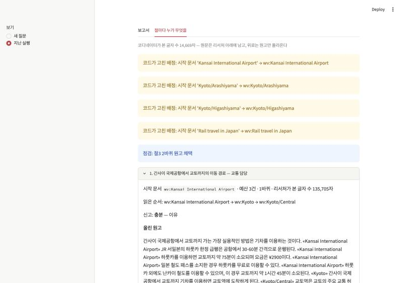

# my-deep-researcher — 오사카·교토 여행 딥리서처

여행 질문 하나를 코디네이터가 절(구역)로 나눠 리서처 에이전트들에게 맡기고, 리서처가 각자 읽은 문서만 근거로 쓴 원고를 이어 붙여 근거 기반 여행 분석 보고서를 만든다. 자료는 영어 위키보이지·위키백과 34건(650,976자, gpt-4o-mini 창의 1.27배)이고, 보고서는 한국어로 쓴다.

설계와 실험 결과는 [REPORT.md](REPORT.md)에 있다.

## 구성

```
my-deep-researcher/
├── data/
│   ├── collect.py       # 위키보이지·위키백과 API로 코퍼스 수집 (글자 수·토큰·링크 집계 출력)
│   ├── corpus.json      # docs 34건 + links (코퍼스 안 문서끼리만)
│   └── questions.json   # 질문 11건과 "왜 나눌 만한가"
├── config.json          # 절 수 · 절 예산 · 바퀴 상한 · 역할 명단 등 도메인 값
├── graph.py             # 기획 → 배치 → 조사(서브에이전트) → 점검 → 종합 (LangGraph)
├── metrics.py           # 정답표·판정 모델 없이 세는 지표
├── baseline.py          # 단일 에이전트 대조군 (같은 자료·모델·도구·읽기 예산)
├── ablation.py          # 시작 문서 배정을 끄고 기본·대조군과 견주는 실험
├── app.py               # 웹 데모 (Streamlit) — 보고서 + 절마다 누가 무엇을 읽고 썼는지
├── docs/                # 데모 화면 캡처
├── output/              # runs.jsonl · ablation.json · reports/
└── REPORT.md
```

## 실행

Python 3.12 이상, OpenAI API 키가 필요하다.

```bash
python3 -m venv .venv
.venv/bin/pip install -r requirements.txt
echo "OPENAI_API_KEY=sk-..." > .env
```

질문 하나를 돌린다 (질문 id 또는 질문 문장). 보고서는 `output/reports/`, 실행 기록은 `output/runs.jsonl`에 쌓인다.

```bash
.venv/bin/python graph.py Q3
```

같은 질문을 단일 에이전트로 돌린다. 읽기 예산은 같은 질문의 가장 최근 기본 실행이 실제로 읽은 횟수로 맞춘다.

```bash
.venv/bin/python baseline.py Q3
```

최근 실행들의 지표를 본다 (숫자는 몇 개를 볼지).

```bash
.venv/bin/python metrics.py 5
```

시작 문서 배정을 끈 실험 (기본 · 단일 · 배정 끔 × 3회). 질문을 고르면 그 질문만 다시 돌린다.

```bash
.venv/bin/python ablation.py Q3 Q6 Q8
```

코퍼스를 처음부터 다시 모은다 (위키미디어 요청 제한 때문에 10분쯤 걸린다).

```bash
.venv/bin/python data/collect.py
```

## 데모

```bash
.venv/bin/streamlit run app.py
```

브라우저에서 `http://localhost:8501`을 연다. 왼쪽에서 **새 질문**(직접 질문해 실행, 1~3분 걸림)이나 **지난 실행**(`output/runs.jsonl`의 기본 · 배정 끔 · 단일 기록)을 고른다. **절마다 누가 무엇을** 탭에서 절마다 역할 · 시작 문서 · 예산 · 읽은 순서 · 올린 원고 · 코드가 걸러 낸 줄을 펼쳐 본다.



## 자료 출처

위키보이지(Wikivoyage)·위키백과(Wikipedia) 영어판, CC BY-SA 4.0.
