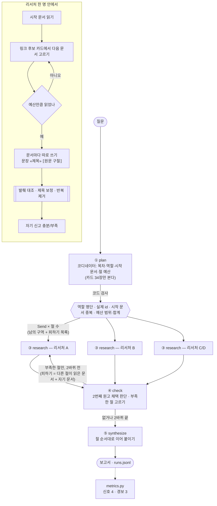

# REPORT — 오사카·교토 여행 딥리서처

여행 질문 하나를 코디네이터가 내용 단위의 절로 나누고, 리서처 에이전트들이 각자 맡은 구역의 문서만 읽고 쓴 원고를 이어 붙여 근거 기반 보고서를 만든다. 정답표·판정 모델 없이 코드가 세는 지표로 명백한 실패를 거르고, 시작 문서 배정을 끈 설정·단일 에이전트 대조군과 나란히 놓고 사람이 읽어 고른다.

---

## 1. 주제와 코퍼스

### 왜 이 주제인가
"오사카·교토 7일 여행 계획"은 한 문서로 답이 나오지 않는다. 지역별 관광지는 위키보이지 지역 문서에, 도시 간 이동은 철도 문서에, 시기는 하나미·관광 정책 문서에 흩어져 있고, 문서끼리 링크로 서로를 가리킨다. 산출물도 일정·지역·이동·시기를 다 담아야 해서 장문이 된다.

### 코퍼스 (`data/corpus.json`)
| 항목 | 값 |
|---|---|
| 출처 | 영어 위키보이지 19건(지역·교통) + 영어 위키백과 15건(관광지·교통·시기) |
| 문서 수 | **34건** |
| 총 글자 수 | **650,976자** |
| 토큰 (tiktoken, gpt-4o-mini) | **162,528 토큰 = 창 128,000의 1.27배** → 한 창에 다 들어가지 않는다 |
| 링크 | 코퍼스 안 문서끼리만. 나가는 링크 0개인 문서 없음 |
| 수집 | `data/collect.py` — MediaWiki API(TextExtracts + links), 429 요청 제한 재시도 |

수집하며 내린 결정
- **넘겨주기 중복 3건 제거** — `Osaka/Central`→`Osaka`, `Kyoto/East`→`Kyoto/Higashiyama`, `Osaka/Nipponbashi`→`Osaka/Minami`. 처음엔 같은 문서가 두 번 들어가 총량이 부풀었다.
- **토막글 제거** — `Momijigari`(104자).
- **나가는 링크 0개 문서 교체** — `Japan Rail Pass`·`wp:Arashiyama`·`Visa policy of Japan`은 같은 내용을 링크 있는 문서(`Rail travel in Japan`, `Kyoto/Arashiyama`)가 담고 있어 뺐고, `Gion Matsuri`는 `Yasaka Shrine`으로 바꿨다.
- **한계: 표가 사라진다** — TextExtracts는 본문만 주고 표를 버린다. 비자 문서의 국가별 무비자 기간 표가 통째로 없어 처음 Q1(한국인 무비자 기간)은 답이 원문에 없었다. 요금표 같은 숫자도 빠졌을 수 있다.

### 질문 세트 (`data/questions.json`, 11건)
| 유형 | 질문 | 왜 나눌 만한가 (또는 아닌가) |
|---|---|---|
| 한 건 | Q1 도다이지와 대불은 언제, 누가, 왜 만들었나 | 「Tōdai-ji」 한 건에 답이 있다 — 나누면 안 되는 경우 |
| 한 건 | Q2 ICOCA는 어느 지역·노선에서 쓸 수 있나 | 「ICOCA」 한 건으로 끝난다 — 대조용 |
| 흩어짐 | **Q3 오사카·교토 7일 여행의 가장 효율적인 계획** (핵심 질문) | 지역 문서 10여 건·교통·시기 문서에 흩어져 한 창에 다 담을 수 없다 |
| 흩어짐 | Q4 오사카↔교토 JR·한큐·게이한 비교와 패스 | 노선마다 문서가 따로 있다 |
| 흩어짐 | Q5 벚꽃 시즌·기온 마쓰리 때의 차이 | 시기 문서·야사카 신사·지역 문서에 흩어져 있다 |
| 흩어짐 | Q6 근교 당일치기 나라·우지·고베·히메지 비교 | 도시마다 문서가 하나씩 — 도시 = 절 |
| 흩어짐 | Q7 교토 오버투어리즘이 동선에 주는 영향 | 정책 문서와 혼잡 지역 문서에 흩어져 있다 |
| 한 대상 | Q8 간사이 공항 → 아라시야마 숙소까지 | 공항 → 철도 → 교토 → 아라시야마를 링크로 따라가야 한다 |
| 한 대상 | Q9 기요미즈데라 중심 히가시야마 하루 | 한 장소에서 주변으로 넓혀 간다 |
| 한 대상 | Q10 오사카성 → 텐노지 → 도톤보리 하루 | 한 경로를 지역·지하철 문서로 따라간다 |
| 한 대상 | Q11 USJ 하루와 베이 에어리어 | USJ에서 베이 에어리어·교통으로 넓혀 간다 |

정답표는 만들지 않았다.

---

## 2. 분업 설계

### 무엇을 절로 나누는가
**절(구역) = 장소나 주제 덩어리, 전문성 = 역할.** 처음 생각한 "관광지·교통·지역·정책 전문 에이전트"를 그대로 절로 쓰면, 위키보이지 지역 문서 하나에 볼거리(See)와 교통(Get around)이 함께 있어 세 리서처가 모두 같은 `Kyoto/Higashiyama`를 집는다. 그래서 전문성은 프롬프트 첫 줄인 **역할**로 옮기고, 절은 읽을 문서가 갈리는 **장소·주제**로 나눴다. 기준은 하나 — "절마다 읽는 문서가 갈리는가".

실제로 겪은 실패: 규칙만 적었을 때 gpt-4o-mini는 질문에 적힌 "관광지·교통수단·이동 동선·여행 시기"를 그대로 목차로 옮겼고(교토 절이 아예 없음), 절1·절2가 같은 1~7일차 일정표를 썼다. **다른 도시(도쿄)로 만든 나쁜 목차·좋은 목차 예시**를 넣자 Q3 목차가 `오사카 관광지 · 교토 관광지 · 오사카↔교토 이동 · 여행 시기`로 고정됐다. Q3를 예시로 쓰지 않은 것은 모델이 정답을 베끼지 않게 하려는 것이다.

### 역할 명단 (`config.json`)
| 역할 | 프롬프트 첫 줄 |
|---|---|
| 큰그림 담당 | 그 지역·주제의 윤곽을 잡고 꼭 볼 곳을 간추린다 |
| 동선 담당 | 장소들을 어떤 순서로 묶어 돌지, 장소 사이를 무엇으로 잇는지 자료에 적힌 대로 정리한다 |
| 교통 담당 | 노선·패스·카드·요금·소요 시간을 못 박는다 |
| 시기 담당 | 계절·행사·혼잡 시간대와 그때 달라지는 점을 뽑는다 |
| 규정 담당 | 입국·이용 규칙·제한·예절처럼 여행자가 지켜야 할 것을 뽑는다 |
| 비교 담당 | 둘 이상을 같은 잣대로 견주어 어디가 다른지 정리한다 |

### 설정값
| 값 | 설정 | 이유 |
|---|---|---|
| 모델 | gpt-4o-mini (창 128K) | 수업과 같아 코퍼스로 창을 넘기기 쉽고, 반복 실험 비용이 낮다 |
| 절 수 상한 | 4 | 수업과 같음. 37건 안팎 코퍼스에서 절을 더 늘리면 중복이 는다 |
| 절 예산 | 코디네이터가 절마다 **2~4건**, 합계 **12건 이하** | 넓은 절에 더 준다. 코드가 범위·합계를 검사 |
| 바퀴 상한 | 2 | 1바퀴 전원 + 부족한 절만 1번 더 |
| 카드 | 제목 + 앞 250자 | 코디네이터가 본 양은 카드 34장 약 1.1만~1.5만 자(코퍼스의 약 2%) |
| 문서당 최소 문장 | 5 | 리서처가 읽은 문서를 버리지 않게 |

### 배정·구역 규칙
- **코디네이터(① 기획)** — 목차·역할·시작 문서·예산을 정한다. 코드가 검사한다: 명단에 없는 역할 → 큰그림 담당, **카드에 없는 id(지어낸 제목) → 가장 가까운 실제 id**, **시작 문서가 겹치는 절 → 버림**(겹친다는 것은 나눌 필요가 없다는 신호. 처음엔 다른 문서로 바꿨는데 질문과 무관한 `Universal Studios Japan`이 배정됐다), 예산 범위 밖 → 범위 안으로, 합계 초과 → 가장 큰 절부터 1건씩 줄임.
  - 코드 검사가 실제로 잡은 것: Q8에서 코디네이터가 `Kansai International Airport`처럼 `wv:` 접두어 없는 id를 냈고 코드가 4건 모두 실제 id로 바로잡았다. Q1에서는 시작 문서가 겹친 두 절을 버렸다. Q6에서는 명단에 없는 역할 `비교`(정답은 `비교 담당`)를 큰그림 담당으로 바꿨는데 — 코드는 형식만 바로잡을 뿐 뜻을 살리지 못한다는 예다.
  - 예산 배정: Q2는 노선 절에 4건·개요 절에 3건, Q6는 나라·고베 3건·우지·히메지 2건을 줬다. Q3·Q8은 네 절 모두 3건.
- **배치(②)** — 리서처를 `Send`로 동시에 보낸다. 각자에게 **남의 구역**(다른 절 제목·시작 문서)과 **피하기 목록**(1바퀴: 다른 절 시작 문서, 2바퀴: 다른 절이 실제로 읽은 문서 + 자기가 읽은 문서)을 준다.
- **리서처(③ 조사)** — 시작 문서를 읽고, 읽은 문서의 링크 후보 카드에서 다음 문서를 고른다. 링크가 막히면 남은 문서 전체로 넓힌다. 예산만큼 읽은 뒤 **문서 한 건씩 따로** 원고를 쓴다(한 번에 주면 맨 앞 문서에서만 쓰고 나머지를 버렸다). 원고 형식은 한 줄에 `문장 «문서 제목» ⟦영어 원문 구절⟧`.
- **발췌 대조(코드)** — 문장마다 붙은 원문 구절이 그 문서와 **연속 30자 이상** 그대로 겹치는지 본다. 30자 기준은 데이터에서 정했다: Q3 기록에서 지은 구절은 원문과 겹침이 18자 이하, 옮긴 구절은 44자 이상으로 갈렸고 그 사이가 비어 있었다. 구절이 다른 읽은 문서에 있으면 **제목을 그 문서로 바로잡는다**(구절이 출처를 증명한다). 맞지 않는 문장·되풀이 문장은 지우고 이유를 남긴다.
- **자기 신고** — 원고를 다 쓴 뒤 원고만 보고 `충분/부족`을 따로 신고한다. "기본은 충분, ① 문장 5개 미만 ② 절 제목의 장소·주제를 다룬 문장이 없을 때만 부족"이라는 조건을 준다.
- **점검(④)** — 부족하다고 신고한 절만 2바퀴로 다시 내보낸다(상한 2바퀴).
- **두 번째 원고 처리** — 2바퀴 리서처는 1바퀴 원고 줄(이미 대조 통과)을 **코드가 그대로 이어받고** 새 문서 몫만 덧붙인다. 원고를 다시 쓰게 했을 때 1바퀴 문장(`Osaka/Minami`의 도톤보리)에 새 문서 제목(`Osaka/Bay Area`)을 갈아 끼우는 오귀속이 생겼기 때문이다. 채택은 "**유효하게 인용한 서로 다른 문서 수가 줄지 않을 때**"만 한다. 인용 *횟수*로 견줬을 때는 같은 문장을 129번 되풀이한 폭주 원고가 멀쩡한 2바퀴 원고를 이겨 살아남았다.
- **종합(⑤)** — 채택된 원고를 절 순서대로 이어 붙인다(코드, 모델 호출 없음).

### 격리 (Q3 기본 1회 실행)
| 누가 | 본 글자 수 |
|---|---|
| 코디네이터 (카드 + 올라온 원고) | **14,450자** |
| 리서처 A 오사카 (Osaka, Osaka/Minami, Osaka/Kita) | 85,507자 |
| 리서처 B 교토 (Kyoto, Kyoto/Higashiyama, Kyoto/Central) | 151,112자 |
| 리서처 C 이동 (Rail travel in Japan, Kansai, Nara) | 120,147자 |
| 리서처 D 시기 (Hanami, Osaka Castle, Tourism in Japan) | 49,713자 |
| 리서처 합 | 406,479자 |

원문은 리서처 창 안에만 있고 코디네이터에게는 원고만 올라간다.

---

## 3. 지표 (`metrics.py`)

정답표도 판정 모델도 쓰지 않는다. 만들어진 보고서와 실제로 읽은 기록만 본다.

### 높낮이를 견주는 신호
| 지표 | 한 줄 정의 | 지켜보는 장치 |
|---|---|---|
| 근거 비율 | 문장 중 «»가 붙은 문장의 비율 (절별로도) | 쓰기 규칙 · 절 예산 · 다시 맡기기 |
| 읽고 안 쓴 문서 | 읽었는데 한 번도 인용되지 않은 문서 수 | 시작 문서 배정 · 다음 문서 고르기 · 문서별 쓰기 |
| 편중 | 가장 많이 인용된 문서의 몫 | 배정 · 피하기 목록 |
| 중복률 | 1 − 서로 다른 문서 수 ÷ 읽기 횟수 | 피하기 목록 · 배정 |

### 0이어야 하는 경보
| 지표 | 한 줄 정의 | 지켜보는 장치 |
|---|---|---|
| 허위 인용 | 그 절의 리서처가 읽지 않은 문서를 인용 (코드가 지운 줄 포함) | 조사 격리 · 쓰기 규칙 |
| 반복 문장 | 코드가 지운 되풀이 문장 수 (기각된 바퀴 포함) | 쓰기 호출 (폭주) |
| 발췌 불일치 | 원문 구절이 문서에 없거나 너무 짧거나 없어서 지운 문장 수 | 쓰기 규칙 · 모델의 지어내기 |

허위 인용은 수업보다 엄격하게 "아무도 안 읽은 문서"가 아니라 **"그 절의 리서처가 안 읽은 문서"**로 센다. 리서처는 자기가 읽은 원문만 보므로, 다른 절이 읽은 문서를 인용했다면 본 적 없는 문서를 인용한 것이다.

### 기록 (지표가 아님)
코디네이터·리서처가 본 글자 수(격리 증명), 보고서 글자 수, 다시 나간 절 수, 제목 보정 내역.

### 문장 분리 규칙 (처음에 고정, 바꾸지 않음)
`#` 제목 줄과 빈 줄은 세지 않는다 · 마침표 바로 뒤의 «»는 앞 문장 몫 · 목록은 한 줄 = 한 문장. 처음 규칙은 `상징이다. «Osaka» 도톤보리는…`을 한 문장으로 셌다 — 예시 문장으로 먼저 시험해 잡았다.

### 숫자가 못 보는 것
발췌 대조는 "구절이 원문에 있는가"만 본다. **"문장이 그 구절과 같은 말인가"는 사람만 본다** (5장 참고).

---

## 4. 파이프라인 구조도

### 상태(State)
| 필드 | 쓰는 노드 | 내용 |
|---|---|---|
| `question` | 입력 | 질문 |
| `assign` | 입력 | 스위치: 시작 문서 배정 (ablation에서 끔) |
| `sections` | plan | 절마다 title · role · start_doc · budget |
| `plan_fixes` | plan | 코드가 고친 배정 내역 |
| `coordinator_chars` | plan, check | 코디네이터가 본 글자 수 |
| `round`, `todo` | plan, check | 바퀴 번호, 이번 바퀴에 내보낼 절 |
| `results` | research (누적 reducer) | 리서처가 올린 원고·읽은 문서·신고·지운 줄·제목 보정 (바퀴마다 쌓임) |
| `drafts` | check | 절 번호 → 채택된 원고 |
| `decisions` | check | 2번째 원고 채택/기각 기록 |
| `report` | synthesize | 최종 보고서 |

---

## 5. 결과물 비교와 실패 분석

### 대조군이 공정한가 (`baseline.py`)
| 조건 | 멀티(기본) | 단일 |
|---|---|---|
| 자료 · 모델 · temperature | 코퍼스 34건 · gpt-4o-mini · 0 | 같음 |
| 도구 | 카드 보고 다음 문서 고르기, 링크 따라가기 | 같음 (첫 문서도 전체 카드에서 스스로) |
| 쓰기 형식·규칙 · 발췌 대조 코드 | `문장 «제목» ⟦구절⟧`, 문서 뒤에 규칙 | 같음 (+ "최대 4절") |
| 읽기 예산 | 그 실행이 실제로 읽은 횟수 | **같은 횟수, 매번 다 씀 (코드가 확인)** |
| 출력 상한 | 리서처당 4,000 토큰 | 16,000 토큰(4,000×4절), 창을 넘으면 창에 맞춰 줄임 |

대조군을 묶지 않으려고 바꾼 것: 처음엔 쓰기 규칙이 문서 *앞*에 있어 9만 토큰 문맥의 대조군이 형식을 놓치고 줄이 통째로 지워졌다(보고서 131자). 규칙을 **두 쪽 모두** 문서 뒤로 옮기고, 창 초과로 API가 거절한 실행이 나와 출력 상한을 창에 맞췄다.

### Ablation — 시작 문서 배정을 끈다 (`ablation.py`, `output/ablation.json`)
배정 끔 = 목차·역할·예산은 그대로, 시작 문서만 지움 (리서처가 전체 카드에서 첫 문서를 고름). 1바퀴 피하기 목록은 다른 절 시작 문서로 만들기 때문에 함께 빈다. 스위치가 로그만 찍고 경로는 그대로인 사고를 막으려고, 실행 기록에서 시작 문서가 실제로 비었는지(기본은 차 있는지) 코드가 확인한다.

최종 코드로 Q3·Q6·Q8 × 기본·배정 끔·단일 × 3회 = 27회. 3회의 최소~최대.

| | 중복률 | 편중 | 읽고 안 쓴 문서 | 보고서 | 반복 문장 | 발췌 불일치 | 읽기 횟수 |
|---|---|---|---|---|---|---|---|
| Q3 기본 | **0%** | **15~18%** | 0~1 | 3,424~4,584자 | 0~1 | 1~4 | 12 |
| Q3 배정 끔 | **42%** | **24~30%** | 0~1 | 2,563~4,142자 | 0~4 | 7~13 | 12 |
| Q3 단일 | (0%) | 46~57% | **9** | **658~780자** | 0 | 0~3 | 12 |
| Q6 기본 | **15~40%** | **18~23%** | 0~5 | 1,418~1,517자 | 5~12 | 15~25 | 10~13 |
| Q6 배정 끔 | **43~54%** | **26~34%** | 4~7 | 2,643~3,400자 | 9~18 | 33~50 | 18~24 |
| Q6 단일 | (0%) | 25~26% | 5~9 | 852~956자 | 0 | 0~1 | 10~13 |
| Q8 기본 | **27~33%** | **20~23%** | 1~2 | 3,834~4,108자 | 1~4 | 5~22 | 15 |
| Q8 배정 끔 | **47~58%** | **33~38%** | 0~2 | 3,029~3,635자 | 3~12 | 9~19 | 12~15 |
| Q8 단일 | (0%) | 50~61% | **11~12** | 1,210~2,083자 | 0 | 0 | 15 |

허위 인용은 Q8 기본 1회(9줄, 코드가 지움) 말고는 0. 근거 비율은 멀티 쪽이 모두 90~100%라 견줄 신호가 못 됐다.

읽은 것
- **배정은 중복률과 편중을 지켰다.** 세 질문 모두, 3회 모두 배정을 끄면 중복률과 편중이 올랐고 범위가 겹치지 않는다(시행마다 흔들리는 폭으로 설명되지 않는다). 지켜보는 장치를 끄자 그 장치의 지표가 움직였다. 원인은 기록에 그대로 있다 — 배정을 끄면 Q3 리서처 넷이 `Osaka`·`Kyoto`·`Osaka`·`Kyoto`로, Q8은 넷 다 `Kyoto/Arashiyama`로 출발했다.
- **배정은 분량 장치가 아니다.** Q6는 배정을 끄자 오히려 보고서가 길었다(읽기 18~24회). 겹쳐 읽은 리서처들이 '부족'을 신고해 2바퀴를 더 돌았기 때문이고, 그만큼 반복 문장·발췌 불일치도 늘었다.
- **단일의 중복률 0%는 장점이 아니다.** 혼자 읽으니 겹칠 상대가 없을 뿐이다. 대신 같은 예산에서 읽은 문서 5~12건을 한 번도 쓰지 못했고 보고서가 멀티의 1/5~1/2이다. 지표를 순위표로 쓰지 않은 이유다.
- **Q8(한 대상 따라가기)은 배정이 있어도 중복률 27~33%.** 공항에서 아라시야마까지 한 경로를 따라가면 절이 달라도 같은 문서로 모인다.
- **Q6 기본은 1,500자 안팎으로 짧고 발췌 불일치가 15~25줄로 많다.** 근교 도시 문서에서 지어낸 구절이 많이 걸러졌다. 장문 목표에는 못 미친다.

### 사람이 나란히 읽고 고르기 (Q3)
읽은 보고서: [기본](output/reports/Q3_20261106-173705.md) · [배정 끔](output/reports/Q3_20261106-173706_noassign.md) · [단일](output/reports/Q3_20261106-173705_baseline.md). 절별 예산 배정을 넣기 직전 실행이지만, 최종 코드로 돌린 Q3에서도 코디네이터는 네 절 모두에 3건을 줬다 — 같은 조건이다. 최종 실행 1회차: [기본](output/reports/Q3_20261106-221005.md) · [배정 끔](output/reports/Q3_20261106-221005_noassign.md) · [단일](output/reports/Q3_20261106-221005_baseline.md).

**판단: 기본이 가장 낫다.** 일부 정보에 오류가 있더라도 기본적으로 읽는 데 필요한 정보가 충분해서, 그걸 기준으로 더 찾아보는 게 낫다.

그렇게 본 이유
- **기본** — 오사카(미나미·키타 세부), 교토(히가시야마 하루 동선과 가까운 역), 이동(JR 30분·한큐 45분·게이한 51분 비교), 시기(하나미 3월 말~4월 초, 1~2주)를 다 다룬다. 문장마다 출처가 붙어 틀린 곳을 원문에서 바로 확인할 수 있다.
- **배정 끔** — 교토 절은 오히려 풍부하지만, 리서처 넷이 `Osaka`·`Kyoto`·`Osaka`·`Kyoto`로 둘씩 같은 문서에서 출발해 **철도 문서를 아무도 읽지 않았다.** 이동 절이 도시 문서의 일반론뿐이고 "한큐 1시간 45분" 같은 틀린 숫자가 들어갔다. 숫자(중복률 50%)와 내용이 같은 이야기를 한다.
- **단일** — 같은 12건을 읽고 1,707자, 같은 말(주요 관광지, JR 30분, 3일+4일)이 2~3번 되풀이되고, 읽은 문서 절반 이상을 쓰지 않았다. 7일 일정을 낸 유일한 보고서지만 그 일정은 원문 구절이 아니라 모델의 추론이다.
- **공통 한계** — 세 편 모두 질문이 물은 "7일 계획"을 근거와 함께 짜지 못했다. ⑤ 종합이 이어 붙이기뿐이기 때문이다.

### 마음에 안 드는 대목 → 어느 절, 어느 자료까지 추적
| 대목 | 보고서 · 절 | 추적 결과 |
|---|---|---|
| 교통 절에 도톤보리 5문장 | 기본(이전 실행) · 교통 절 | 1바퀴 `Osaka Metro`·`ICOCA`·`Keihan` 뒤, 2바퀴에서 교통 문서는 피하기 목록에 들어가 남은 후보 중 `Dōtonbori`·`USJ`를 골랐고, "문서마다 5문장"을 채우려 무관한 내용을 썼다 |
| "신칸센은 약 15분" | 기본 · 이동 절 | `Rail travel in Japan`의 ⟦the bullet train, known by its Japanese name Shinkansen…⟧ — 구절에 시간이 없다. 숫자를 지어냈다 |
| "난바역에서 출발하는 **한큐** 나라선" | 기본 · 이동 절 | `Nara`의 ⟦…private **Kintetsu** Nara Line from Osaka-Namba…⟧ — 회사 이름을 잘못 옮겼다 |
| "겨울철 스키 리조트와 온천…" | 기본 · 시기 절 | `Tourism in Japan`의 ⟦Domestic tourism remains a vital part…⟧ — 구절과 무관한 일반론 |
| "한큐로 교토까지 약 1시간 45분" | 배정 끔 · 이동 절 | `Kyoto`의 ⟦…upgrade to the fastest Nankai train service, the Rapi:t…⟧ — 다른 노선 이야기 |
| "첫 3일 오사카, 다음 4일 교토" | 단일 | `Osaka`의 ⟦…Osaka a perfect base for doing one-day trips to nearby cities like Kyoto…⟧ — 구절은 오히려 오사카에 묵으며 교토 당일치기를 권한다 |
| 도톤보리 문장에 `«Osaka/Bay Area»` | 기본(이전 실행) · 오사카 절 | 2바퀴에 원고를 다시 쓰며 1바퀴 `Osaka/Minami` 문장에 새 문서 제목을 갈아 끼움 → 2바퀴는 지난 줄을 코드가 이어받도록 고침 |

이 중 앞의 다섯은 구절이 원문에 실제로 있어 **코드 검사를 모두 통과**했다. 읽은 문서를 엉뚱한 문장에 붙인 것은 사람만 잡는다.

### 이 구조를 쓰면 안 되는 경우 — 한 건 질문 (Q1)
코디네이터가 4절을 짰고 그중 세 절의 시작 문서가 `Tōdai-ji`였다. 코드가 겹친 두 절을 버려 2절이 남았는데, 두 번째 절 "도다이지 방문 시기와 행사"는 `Hanami`에서 출발했다(`Tōdai-ji`는 1절의 시작 문서라 피하기 목록에 있었다). 이 리서처는 도다이지 문서를 끝내 읽지 못하고 "**도다이지 근처 공원에서 벚꽃 소풍… 도다이지에서 특별한 행사가 열린다**"를 써서 `«Hanami»`·`«Tourism in Japan»` 구절을 붙였다 — 답이 든 문서를 못 받은 리서처가 빈칸을 지어낸 것이다. 같은 질문에 단일 에이전트는 `Tōdai-ji` 한 건으로 738년 창건·752년 개안식·쇼무 천황·대불 높이 14.98m를 정확히 썼다. **한 건으로 답이 나오는 질문은 나누지 않는 것이 낫다.** (이전 버전에서 JESTA 질문을 나눴을 때도 비자 문서를 못 받은 리서처가 "2024년 1월 1일 시행"을 지어냈다. 원문은 "2030년까지 도입 계획".)

---

## 6. 데모 설계

<!-- TODO: app.py 화면 구성, 신경 쓴 부분, 화면 캡처 -->

---

## 7. 프로젝트 회고

### 가장 공들인 부분 — 인용이 "붙는 것"에서 "맞는 것"으로
같은 Q3를 설정마다 3번씩 돌리며 한 가지씩 바꿨다.

| 단계 | 근거 비율 | 무엇이 문제였나 → 무엇을 바꿨나 |
|---|---|---|
| id로 인용 | 2~26% | 인용을 거의 안 달고 `wv:`/`wp:` 접두어를 틀림 → 문서 제목으로 인용 |
| 문단 글 + 평문 출력 + 길이 상한 | 9~14% | 문단 끝에 인용 하나, `«Kyoto/North»`를 다섯 문단에 반복(오귀속) → 한 줄 = 한 문장 |
| 한 줄 = 한 문장 «제목» | 93% | 오사카 절이 같은 문장을 129번 반복(편중 82%) → 반복 제거, 2번째 원고 기준을 문서 종류 수로 |
| + 원문 구절 대조 | 94~100% | 인용은 맞아졌지만 멀쩡한 문장까지 지움 → 겹침 30자 기준(데이터에서 정함), 제목 보정 |
| + 규칙을 문서 뒤로 | 100% | 반복 폭주 사라짐. 대신 첫 문서에서만 씀 → 문서별 쓰기 |
| + 한 줄 안 여러 묶음 따로 대조 | 98~100% | 첫 구절만 대조되고 뒤 문장이 사라지던 버그 수정 → 보고서 1,760자 → 4,340자 이상 |

에이전트 결과를 의심한 장면
- **지표를 고치지 않았다.** 근거 비율이 낮을 때 "문단 단위로 세면 오른다"는 유혹이 있었지만, 세는 방법을 바꾸면 좋아진 건지 잣대가 바뀐 건지 모른다. 바꾼 것은 원고를 받는 방식이다.
- **내 판단도 원문 대조로 뒤집혔다.** "지어낸 구절"로 분류한 17줄 중 상당수가 사실 *다른 문서의 진짜 구절*이었다(예: "ICOCA is fully interoperable…"는 `Osaka Metro`에 있다). 오귀속이었던 것을 제목 보정으로 바로잡았다.
- **한 번 돌린 결과로 단정하지 않았다.** 같은 설정·temperature 0에서도 근거 비율이 25.5%와 2.4%로 갈린 적이 있다. 비교는 모두 3회씩 했다.
- **스위치가 실제로 켜졌는지** 실행 기록에서 코드가 확인한다.

### 향후 보완하고 싶은 점
1. **⑤ 종합에 일정 짜기** — 지금은 이어 붙이기뿐이라 Q3가 물은 "7일 계획"이 어느 보고서에도 근거와 함께 나오지 않는다. 코디네이터가 절 원고만 보고 일정을 짜되, 일정의 각 칸이 원고 문장을 가리키게 하고 싶다.
2. **문장–구절 일치** — 발췌 대조는 구절의 존재만 본다. "신칸센 15분"처럼 구절에 없는 숫자를 문장에 넣는 경우는 숫자·고유명사가 구절에 있는지 코드로 견주는 방법을 시험해 보고 싶다(기준값을 정할 근거가 있어야 한다).
3. **자기 신고의 쏠림** — gpt-4o-mini의 신고는 프롬프트에 따라 전부 '충분' 또는 전부 '부족'으로 쏠렸다. 조건을 준 뒤에야 갈렸지만, 문장 3개인데 "5개 이상이라 충분"이라고 한 오판이 남았다.
4. **2바퀴의 엉뚱한 문서** — 관련 문서가 피하기 목록에 다 들어가면 남은 후보 중 무관한 문서를 고르고 "문서당 5문장"을 억지로 채운다. 관련 후보가 없으면 읽지 않고 멈추는 선택지가 필요하다.
5. **한 대상 유형(Q8)** — 한 경로를 따라가는 질문은 배정이 있어도 절들이 같은 문서로 모인다(중복률이 높다). 이 유형은 나누는 이득이 작다.
6. **코퍼스의 표 손실** — 요금표·국가표 같은 표가 사라진다. 표를 따로 추출해 붙이면 Q4(패스가 값을 하는가) 같은 질문에 답할 수 있다.
